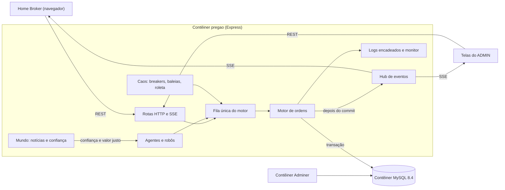

# Pregão Norte

Simulador de bolsa de valores multiplayer feito para o Projeto 1 de Sistemas Distribuídos (UFS). Vários investidores entram no mesmo mercado, mandam ordens limitadas e acompanham o livro de ofertas mudando em tempo real. Robôs com estratégias diferentes mantêm o mercado ativo quando há pouca gente conectada, e um perfil ADMIN controla notícias, falhas e testes de carga.

Stack: Node.js 22, Express, EJS e MySQL 8.4, tudo em contêineres Docker.

## Sumário

1. [Como executar](#como-executar)
2. [Regras do mercado](#regras-do-mercado)
3. [Arquitetura](#arquitetura)
4. [Protocolos de comunicação](#protocolos-de-comunicação)
5. [Banco de dados](#banco-de-dados)
6. [Consistência e concorrência](#consistência-e-concorrência)
7. [Tolerância a falhas](#tolerância-a-falhas)
8. [Agentes](#agentes)
9. [Eventos econômicos (aba Mundo)](#eventos-econômicos-aba-mundo)
10. [O Caos](#o-caos)
11. [Observabilidade](#observabilidade)
12. [Segurança](#segurança)
13. [Perfil ADMIN](#perfil-admin)
14. [Testes](#testes)
15. [Ver o banco](#ver-o-banco)
16. [Requisitos cobertos](#requisitos-cobertos)
17. [Cronograma](#cronograma)
18. [Estrutura do código](#estrutura-do-código)

## Como executar

Pré-requisito: Docker Desktop aberto. Na pasta `projetos/bolsa`:

```powershell
docker compose up --build -d
```

| Serviço | Endereço |
| --- | --- |
| Home Broker | [http://localhost:3000](http://localhost:3000) |
| Adminer (visualizar o banco) | [http://localhost:8081](http://localhost:8081) |
| MySQL para clientes externos | `localhost:3308` |

Cadastre dois investidores em navegadores diferentes (ou numa janela normal e outra anônima). Cada conta nova começa com R$ 100.000,00 em caixa. Ana Conservadora e Bruno Agressivo já operam sozinhos assim que o servidor sobe.

O ADMIN entra com `admin@bolsa.local` e senha `admin123` (variáveis `ADMIN_EMAIL` e `ADMIN_SENHA`).

Para encerrar:

```powershell
docker compose down      # para e remove os contêineres, mantém o banco
docker compose down -v   # também apaga o volume do MySQL
```

Os arquivos estáticos (CSS e scripts do navegador) ficam dentro da imagem. Depois de alterar qualquer coisa em `src/`, suba de novo com `--build`.

### Rodando só o Node fora do Docker

Suba apenas o banco com `docker compose up -d mysql`, copie `.env.example` para `.env` e rode:

```powershell
npm install
npm start
```

O MySQL do Compose fica publicado na porta 3308 porque 3306 e 3307 costumam estar ocupadas por instalações locais. Se a porta 3000 já estiver em uso, troque a do Home Broker com `PREGAO_PORTA` (no PowerShell, `$env:PREGAO_PORTA=3001` antes do `docker compose up`).

## Regras do mercado

- Quatro empresas fictícias de Sergipe:

  | Ticker | Empresa | Preço de lançamento |
  | --- | --- | --- |
  | CIAJ3 | Cajuína do Sertão | R$ 18,50 |
  | PSER4 | Petrosergipe | R$ 36,40 |
  | BSFR3 | Banco do São Francisco | R$ 28,90 |
  | TXIN4 | Têxtil Xingó | R$ 14,25 |

- O preço de cada papel é o do último negócio. Além dele, cada empresa tem um **valor justo**, que só muda com notícias (ver aba Mundo).
- Só existem ordens limitadas. Quantidade inteira de 1 a 100.000; o preço aceita vírgula (`18,50`). Valores são guardados em centavos para não haver erro de arredondamento.
- Prioridade de preço e depois de tempo. Na compra, o maior preço sai primeiro; na venda, o menor. No empate, a ordem mais antiga.
- O negócio sai pelo preço da ordem que já estava no livro. Quem chega depois nunca paga mais (ou recebe menos) que o próprio limite.
- Ninguém negocia consigo mesmo.
- Uma compra reserva `preço limite × quantidade` do saldo. Se executar mais barato, a diferença volta na hora. Uma venda reserva as ações. Cancelar devolve o que sobrou da reserva.
- Ordem pode terminar `aberta`, `parcial`, `executada`, `cancelada` ou `rejeitada`.
- O mercado não fecha; funciona enquanto o servidor estiver no ar.

Capital inicial por tipo de conta:

| Conta | Caixa | Ações |
| --- | --- | --- |
| Investidor humano | R$ 100.000,00 | nenhuma |
| Ana e Bruno | R$ 500.000,00 no total, metade em caixa | a outra metade dividida igualmente entre os quatro papéis |
| Robôs criados pelo ADMIN | capital sorteado na faixa escolhida | de 30% a 70% do capital em ações |
| Contas do teste de carga | R$ 100.000,00 | 100 ações de cada papel |

O capital inicial de cada conta soma caixa e ações, então o lucro ou prejuízo exibido no ranking compara o patrimônio atual com tudo o que a conta recebeu.

## Arquitetura



Cliente e servidor se falam por HTTP. O cliente é a página EJS com o script do Home Broker. O servidor cuida de autenticação, livro, casamento, notificação, agentes e telas de administração. O MySQL guarda usuários, saldos, posições, ordens, negócios, eventos, notícias, testes de carga e sessões.

Existe uma única réplica do serviço `pregao`, e ela é o líder do mercado. Toda operação que mexe em saldo ou carteira entra numa fila de promessas dentro do processo: cada uma só começa depois do commit da anterior. Isso dá ordem total às ordens sem precisar de lock distribuído. O preço dessa escolha é que o Compose não pode escalar o `pregao`: duas réplicas teriam duas filas, duplicariam os agentes e perderiam a ordem total. Replicar exigiria uma fila externa ou eleição de líder, o que ficou como evolução.

Os módulos dentro do processo são separados por responsabilidade (`src/mercado/ordens.js`, `agentes.js`, `mundo.js`, `caos.js`, `protecao.js`), e só o motor de ordens escreve no livro.

## Protocolos de comunicação

- **HTTP/REST** para cadastro, login, consultas e ordens: `POST /api/ordens`, `DELETE /api/ordens/:id`, `GET /api/ordens/:id`, `GET /api/mercado`, `GET /api/carteira`. As rotas do ADMIN ficam em `/api/admin/*`.
- **Server-Sent Events** em `GET /eventos`, autenticado pelo cookie de sessão. Depois de cada commit o servidor publica `MERCADO_ATUALIZADO` e o cliente relê livro, carteira e ordens. Notícias (`NOTICIA`), recomeço de rodada e flush também chegam por esse canal. O servidor manda `retry: 2000`, então o navegador reconecta sozinho se a ligação cair.

Escolhemos SSE em vez de WebSocket porque o cliente só precisa escutar: as ordens já vão por REST. SSE usa o mesmo HTTP do resto da aplicação, passa pelo mesmo cookie de sessão e reconecta sem código extra.

Erros de comunicação têm resposta tipada: 400 para regra de negócio, 401/403 para autenticação e permissão, 409 para conflito, 429 para excesso de ordens e 503 quando o banco ou o breaker do serviço impedem a operação. O Home Broker mostra cada caso como aviso e não perde o que estava na tela.

## Banco de dados

MySQL 8.4 com InnoDB. Foi escolhido por ter transações ACID, `SELECT ... FOR UPDATE` e restrições `CHECK`, que são exatamente o que o casamento de ordens precisa. O esquema base está em `sql/init.sql`; colunas e tabelas novas são criadas por `src/migracoes.js` na subida do servidor, sem perder dados.

| Tabela | Guarda |
| --- | --- |
| `usuarios` | conta, papel (investidor ou admin), perfil do robô, saldo, capital inicial, dívida, estado |
| `ativos` | ticker, preço atual, preço de abertura, valor justo, volume |
| `posicoes` | quantidade, quantidade reservada e preço médio por conta e papel |
| `ordens` | lado, quantidade, restante, preço limite, status |
| `negociacoes` | quem comprou, quem vendeu, quantidade, preço, horário |
| `eventos` | trilha de cada ordem (`ORDER_RECEIVED` ... `CLIENTS_NOTIFIED`) |
| `noticias` | notícias soltas no Mundo, com impacto e valor justo antes e depois |
| `testes_carga` | resultado de cada teste disparado pela aba Admin |
| `sessions` | sessões do Express |

Restrições no próprio banco impedem saldo negativo, reserva maior que a posição e ordem com quantidade ou preço inválidos. Mesmo que um bug no código tente, o MySQL recusa a gravação.

O estado sobrevive ao reinício porque fica no volume `mysql-dados`.

### Migrações

O `init.sql` só roda quando o volume do MySQL é criado. Tudo o que entrou no esquema depois disso fica em `src/migracoes.js`, chamado por `servidor.js` antes de abrir o pregão. Cada passo consulta o `information_schema` antes de alterar: a coluna, o índice ou a restrição só é criada se ainda não existe, e as tabelas novas usam `CREATE TABLE IF NOT EXISTS`. Por isso a mesma rotina serve para um banco recém-criado, para um banco antigo com dados e para um reinício comum, sem perder nada e sem tabela de versões.

- **Colunas novas** entram com `DEFAULT` ou `NULL`, então as linhas antigas continuam válidas. Quando um valor precisa ser calculado (valor justo dos ativos, perfil de Ana e Bruno), um `UPDATE ... WHERE coluna IS NULL` preenche só o que está vazio.
- **Restrições `CHECK`** que esbarram em dado antigo inválido não derrubam a subida: o servidor registra `MIGRACAO_AVISO` e continua, e a restrição é tentada de novo no próximo reinício.
- **Conta ADMIN** é criada se não existir, ou promovida se o e-mail já pertencer a outro papel.
- Cada alteração aplicada sai no log como `MIGRACAO_APLICADA`. Num reinício sobre um banco já migrado, nenhuma aparece.

Para demonstrar, com o Compose no ar:

```powershell
docker compose exec pregao node scripts/demo-migracao.js --pausar
```

O script cria um banco separado (`bolsa_demo_migracao`, o `bolsa` não é tocado) só com o `init.sql` e dados de uso, roda o `migrar()` real e mostra, etapa por etapa: o esquema antigo, os logs da migração, as colunas, tabelas, restrições e índices novos, a comparação linha a linha provando que nenhum dado mudou, a segunda execução sem nenhuma alteração e o MySQL recusando saldo negativo, reserva maior que a posição e ordem inválida. Opções:

| Opção | Efeito |
| --- | --- |
| `--pausar` | espera Enter entre as etapas |
| `--dado-invalido` | grava um saldo negativo antes de migrar, para mostrar o `MIGRACAO_AVISO` e a subida continuando |
| `--manter` | não apaga o banco no fim; dá para abri-lo no Adminer com `root`/`root` |

Depois de alterar o script, suba de novo com `--build`, porque ele roda de dentro da imagem.

## Consistência e concorrência

**Negociação: consistência forte.** Reserva, inserção no livro, casamento, saldo, posição, preço do ativo e histórico são gravados na mesma transação. Se qualquer passo falha, o `ROLLBACK` desfaz tudo e a ordem não aparece no livro. Não existe negócio pela metade nem saldo "em trânsito".

**Ordem das ordens.** Duas ordens que chegam juntas entram na fila na ordem em que o Node as aceitou. Como a fila executa uma transação por vez, não há duas reservas disputando o mesmo saldo. Os `FOR UPDATE` no ativo, no usuário e nas ofertas repetem a proteção dentro do banco, para o caso de algum caminho futuro não passar pela fila.

**Telas dos clientes: atualização logo após o commit.** Os outros investidores só são avisados depois do commit. Entre o commit e a chegada do evento existe uma janela curta em que uma consulta já vê o negócio e uma tela aberta ainda não. A próxima leitura ou o próximo evento alinham todo mundo. Essa defasagem é só de exibição: o saldo em si nunca é eventual.

**Confiança dos robôs: estado em memória.** A confiança em cada papel vive na memória do processo e é recalculada a cada segundo. Se o servidor reiniciar, ela volta a zero, enquanto o valor justo, que fica no banco, é mantido. Foi uma escolha consciente: confiança é humor do mercado, não dado de conta.

## Tolerância a falhas

| O que falha | Como é detectado | O que acontece |
| --- | --- | --- |
| Aba do navegador ou rede do cliente | o SSE cai e o servidor registra `CLIENTE_DESCONECTADO` | o `EventSource` reconecta em 2 s, a sessão continua e as ordens abertas seguem no livro |
| Contêiner `pregao` | healthcheck em `/saude` | ordens, saldos e sessões estão no MySQL; ao voltar, o investidor continua logado e os agentes retomam |
| MySQL indisponível | falha nas gravações | depois de 3 falhas seguidas o breaker do serviço abre e por 10 s as ordens são recusadas na hora (503), sem entrar na fila; passado o prazo, uma ordem testa o banco (meio-aberto) e, se passar, o breaker fecha |
| Preço disparando | variação maior que o limite em relação à referência | circuit breaker do mercado suspende o papel pelo tempo configurado |

Ordem em andamento durante uma queda: ou a transação já fez commit e o negócio existe, ou ela volta atrás e a ordem nunca entrou. Reservas acompanham a mesma transação, então nada fica preso.

### Demonstração de falha

Duas falhas são fáceis de mostrar na apresentação:

1. **Queda do servidor.** Deixe uma ordem aberta e rode:

   ```powershell
   docker compose stop pregao
   docker compose start pregao
   ```

   O Home Broker mostra a desconexão, reconecta quando o contêiner volta, e a mesma sessão e a mesma ordem aparecem na tela.

2. **Banco instável.** Na aba O Caos, injete uma falha de banco por alguns segundos. A aba Logs mostra as falhas, o breaker abrindo, as ordens recusadas, o teste em meio-aberto e o fechamento.

## Agentes

Os agentes são investidores virtuais que operam pela mesma fila e pelas mesmas regras dos humanos. Eles não fazem login; chamam o motor por dentro do processo.

A cada rodada (2 s por padrão), alguns agentes são sorteados. Cada um olha um papel e forma uma **opinião** sobre o preço:

```
valor percebido = valor justo × (1 + confiança/100 × 0,12)
opinião = valor percebido × (1 + viés pessoal de ±4% + ruído de ±1%)
```

O viés é fixo por agente e por papel, então dois robôs enxergam a mesma empresa de forma um pouco diferente, e é isso que gera negócios. Se a opinião está acima do último preço, a chance de comprar sobe; se está abaixo, a de vender. A confiança do mercado empurra essa chance para um lado ou outro.

| Estratégia | Comportamento |
| --- | --- |
| Conservador | só opera quando vê desconto de pelo menos 1%; ordens passivas, sem cruzar o spread |
| Agressivo | cruza o spread quando acha o preço errado e reage rápido a notícias |
| Momentum | na maior parte das vezes segue a tendência dos últimos negócios |
| Contrarian | aposta contra a tendência |
| Aleatório | lado e preço sorteados até 3% do último negócio; ignora notícias |
| Formador de mercado | mantém compra e venda em volta do valor percebido, dando liquidez |

Ana usa a estratégia conservadora e Bruno a agressiva. Os robôs criados pelo ADMIN sorteiam entre as seis.

Limites que valem para todos: nenhuma ordem fica a mais de 5% do último preço, cada agente tem no máximo quatro ordens abertas por papel, e o tamanho da ordem depende do perfil, da convicção e do capital disponível. Isso impede que um robô esvazie o livro numa tacada só.

## Eventos econômicos (aba Mundo)

Notícias mudam o valor justo das empresas e a confiança dos robôs.

- **Geração.** O ADMIN solta uma notícia manual (título, papel ou mercado inteiro, impacto de -40% a +40%) ou liga as notícias automáticas, que saem em intervalos sorteados. Na automática, 15% das notícias afetam o mercado inteiro e o restante se divide igualmente entre boas e ruins.
- **Processamento.** O valor justo do papel é multiplicado por `1 + impacto/100` e gravado em `ativos.fundamento_centavos`. A confiança recebe um choque de 3 pontos por ponto percentual de impacto, limitada a ±100, e depois decai pela metade a cada 120 s (configurável), com um pequeno ruído.
- **Propagação.** A notícia vai para a tabela `noticias`, para o log (`MUNDO_NOTICIA`) e para todos os clientes pelo SSE. O Home Broker mostra um aviso e lista as últimas notícias. Os robôs passam a ver o novo valor percebido na rodada seguinte.

Assim, uma notícia ruim faz os robôs venderem mais e pagarem menos, e o preço anda em direção ao novo valor justo. Se andar rápido demais, o circuit breaker do mercado suspende o papel.

A tela do Mundo também mostra o placar de **ganhos e perdas**: contas no lucro e no prejuízo, retorno médio por estratégia, melhores e piores contas, o índice "comprar e segurar" desde a abertura e a razão entre caixa e ações no mercado. O botão **Recomeçar rodada** cancela as ordens abertas, leva os preços ao valor justo e redistribui o capital dos robôs entre caixa e ações. Serve para comparar estratégias partindo do mesmo ponto.

Uma observação sobre o equilíbrio: na primeira versão, os robôs começavam só com dinheiro e as ações eram poucas. Comprar era sempre o melhor negócio e quase todas as contas terminavam no lucro. Com carteiras divididas entre caixa e ações e com o valor justo servindo de âncora, o resultado passou a depender das notícias e da estratégia.

## O Caos

Aba do ADMIN para estressar o mercado de propósito.

- **Circuit breaker do mercado.** Cada papel tem um preço de referência. Se um negócio afasta o preço mais que o limite (15% por padrão), o papel fica suspenso pelo prazo configurado (30 s) e o motor recusa ordens novas dele. Ao liberar, o último preço vira a nova referência. O ADMIN pode suspender um papel, o mercado inteiro, liberar tudo ou mudar a regra.
- **Breaker do serviço.** Injeta falha de banco por alguns segundos para mostrar o breaker abrindo, ficando meio-aberto e fechando.
- **Alavancagem.** Cada robô toma emprestado até o patrimônio ficar multiplicado pelo fator. Se a margem (patrimônio líquido sobre patrimônio) cai abaixo de 10%, vem a chamada de margem: as ações vão ao livro com desconto, a dívida é paga com o caixa e, se não fechar, o robô quebra.
- **Roleta.** A cada rodada, um robô sorteado pode ganhar uma fortuna (multiplicada pela alavancagem) ou quebrar. Ana e Bruno ficam de fora para o mercado não secar.
- **Baleias.** Um agente com muito capital escolhe um papel e passa por quatro fases: acumula até dominar a fatia pedida, infla o preço, despeja a posição com desconto crescente e, por fim, quita a dívida e sai do mercado. A tela mostra participação, pico, preço de saída e quanto os outros detentores perderam desde o pico.

Tudo o que o caos faz com saldo passa pela mesma fila e pela mesma transação das ordens, e fica no log com o ADMIN que disparou.

## Observabilidade

**Logs estruturados.** Cada passo relevante sai como uma linha JSON com horário, nível, categoria e contexto: `ORDER_RECEIVED`, `ORDER_VALIDATED`, `ORDER_BOOK_INSERTED`, `MATCH_FOUND`, `TRADE_EXECUTED`, `PORTFOLIO_UPDATED`, `CLIENTS_NOTIFIED`, além de rejeições, conexões, cancelamentos, segurança, caos, mundo e ações do ADMIN. As linhas aparecem em `docker compose logs -f pregao` e ao vivo na aba Logs.

**Logs à prova de adulteração.** O servidor mantém os últimos 2.000 registros numa cadeia de hashes: cada linha guarda o SHA-256 da anterior, e o hash dela é `sha256(anterior | conteúdo)`. A aba Logs recalcula cada hash no navegador com a Web Crypto API. Alterar um registro quebra a cadeia daquele ponto em diante, e servidor e navegador apontam qual registro foi mexido. O botão "Simular adulteração" mostra isso acontecendo.

**Rastreio de uma ordem.** A tabela `eventos` guarda a trilha de cada ordem. Num negócio, os eventos ficam na ordem que chegou depois, com `contra_ordem_id` apontando a que estava no livro, então dá para seguir qualquer uma das duas pontas. Na aba Logs, "Rastrear" mostra a trilha completa com o tempo entre os passos.

**Métricas.** A cada 2 s o monitor coleta latência média e p95 (da chegada da ordem até a notificação), ordens e negócios por segundo, CPU e memória do processo, atraso do event loop, ping do MySQL, tamanho da fila, clientes SSE, estado dos breakers e agentes ativos. O painel mostra tudo com gráficos. `GET /metricas` devolve o mesmo retrato em JSON e `GET /saude` só responde se o processo está vivo.

## Segurança

| Requisito | Como é atendido |
| --- | --- |
| Autenticação | senhas com bcrypt, sessão regenerada no login, cookie `HttpOnly` e `SameSite=Lax`, bloqueio de 60 s depois de 5 senhas erradas em 5 minutos |
| Autorização | papel `investidor` ou `admin` na sessão; as telas e rotas do ADMIN respondem 403 para os demais |
| Validação | ticker, lado, quantidade e preço checados no servidor; campos extras no corpo são recusados; corpo limitado a 20 kB |
| Proteção das operações | POST e DELETE da API exigem o cabeçalho `x-pregao`, que um formulário de outro site não consegue mandar; limite de 30 ordens por segundo por usuário; CSP e cabeçalhos de segurança |
| Controle de acesso | o investidor sempre vem da sessão, nunca do corpo da requisição; consultas de ordem filtram pelo dono |
| Saldo e carteira | reserva com `FOR UPDATE` dentro da transação, fila única e `CHECK` no banco |
| Ordens de outros usuários | cancelar exige ser o dono; a tentativa gera `ORDEM_ALHEIA_BLOQUEADA` e 403 |

As sondas de segurança da aba Logs atacam a própria API com uma conta comum e mostram cada ataque barrado: leitura sem sessão, rotas e páginas do ADMIN, ordem sem o cabeçalho anti-CSRF, quantidade negativa, ticker com injeção SQL, `usuarioId` forjado no corpo, compra além do saldo, venda de ações que não tem, saldo negativo direto no banco, cancelar e consultar ordem de outro investidor e força bruta no login.

## Perfil ADMIN

Entrando como ADMIN, o topo ganha quatro abas:

- **Logs**: logs ao vivo com verificação da cadeia de hashes, monitor dos serviços, rastreio de ordens e sondas de segurança.
- **Mundo**: notícias, confiança dos robôs, ganhos e perdas e recomeço da rodada.
- **O Caos**: breakers, falha de banco, alavancagem, roleta e baleias.
- **Admin**: cria N robôs com estratégias sorteadas, liga e desliga os agentes, ajusta o ritmo, dispara testes de carga e mostra o ranking.

No fim da aba Admin fica o **Zerar o mercado (FLUSH)**, que volta o pregão ao estado inicial:

- apaga ordens, negócios, eventos, notícias, posições, histórico de carga, robôs, baleias e contas de carga;
- volta preços e valor justo aos de lançamento e zera o volume;
- volta breakers, caos, mundo, ritmo dos agentes e métricas ao padrão;
- recomeça os IDs das tabelas a partir de 1;
- mantém o ADMIN e as contas humanas, só com R$ 100.000,00 em caixa, e recria Ana e Bruno.

Para executar, é preciso digitar `FLUSH`. Uma opção apaga também as contas humanas e encerra as sessões delas. Os logs da aba Logs não são apagados, porque servem de auditoria; o próprio flush fica registrado como `ADMIN_FLUSH_MERCADO`.

## Testes

### Funcionais

Feitos à mão com dois navegadores (Alice e Beto) e os agentes ligados:

- cadastro, login, logout e sessão mantida depois de reiniciar o contêiner;
- compra e venda com reserva, execução total e parcial, preço do negócio igual ao da ordem do livro;
- cancelamento com devolução da reserva;
- rejeição por saldo insuficiente, quantidade insuficiente, papel suspenso e campos inválidos;
- atualização do Home Broker de um investidor quando o outro negocia;
- reconexão do SSE depois de derrubar o servidor.

### Concorrência

O script `scripts/carga.js` cadastra vários investidores e manda compras simultâneas do mesmo papel:

```powershell
node scripts/carga.js --usuarios 20 --ordens 2
```

O que se verifica depois: nenhuma conta com saldo negativo, nenhuma reserva maior que a posição e nenhuma ordem aceita sem saldo para cobri-la. As consultas de verificação estão na seção [Ver o banco](#ver-o-banco).

### Carga

A aba Admin dispara testes pelo navegador. Cada usuário de teste faz login por HTTP e envia todas as suas ordens ao mesmo tempo que os outros, com compras e vendas sorteadas em todos os papéis e preço até 2% do último negócio. O resultado fica na tabela `testes_carga`.

Condições: 5 ordens por usuário, um teste depois do outro, com o mercado funcionando normalmente (202 agentes ativos operando junto) e a aplicação e o MySQL no Docker Desktop, numa máquina com Windows 11. A latência é medida no cliente, do envio da ordem até a resposta HTTP. CPU e memória são do processo Node, lidas logo ao fim de cada teste.

| Cenário | Usuários | Ordens | Aceitas | Duração | Ordens/s | Latência média | p95 | Máxima | CPU | Memória |
| --- | --- | --- | --- | --- | --- | --- | --- | --- | --- | --- |
| Teste 1 | 5 | 25 | 25 | 0,5 s | 45,6 | 313 ms | 508 ms | 541 ms | 25,2% | 94 MB |
| Teste 2 | 20 | 100 | 100 | 1,9 s | 52,2 | 1,0 s | 1,8 s | 1,9 s | 46,0% | 119 MB |
| Teste 3 | 50 | 250 | 250 | 4,8 s | 51,7 | 2,5 s | 4,6 s | 4,8 s | 29,5% | 131 MB |
| Teste 4 | 100 | 500 | 500 | 9,2 s | 54,3 | 4,8 s | 8,7 s | 9,1 s | 25,7% | 151 MB |
| Sobrecarga | 200 | 1.000 | 1.000 | 18,5 s | 54,2 | 9,5 s | 17,5 s | 18,4 s | 22,9% | 190 MB |

O que os números mostram:

- **Nenhuma ordem foi perdida, rejeitada ou aceita duas vezes**, nem com 200 usuários. Depois do último teste, as checagens de integridade da seção [Ver o banco](#ver-o-banco) deram zero contas com saldo negativo e zero reservas maiores que a posição.
- **A vazão para em torno de 52 a 54 ordens por segundo** a partir de 20 usuários. Mais clientes não aumentam o processamento, só aumentam a espera. Isso dá cerca de 18 ms por ordem, que é o tempo de uma transação com reserva, casamento, atualização de saldo e posição e gravação dos eventos.
- **A latência cresce em linha reta com a carga**: dobra de 50 para 100 usuários e de novo de 100 para 200. É o comportamento de uma fila única, em que cada ordem espera todas as que chegaram antes.
- **O gargalo não é CPU nem memória.** A CPU ficou entre 23% e 46% e a memória subiu de forma moderada (94 MB para 190 MB, puxada pelas sessões e conexões novas). O limite está na serialização das transações, que é justamente o que garante a ordem total e impede que duas ordens usem o mesmo saldo.
- **Sob sobrecarga o sistema degrada, mas não falha**: as respostas ficam lentas, nenhuma é perdida e o mercado continua consistente. Os robôs também esperam na mesma fila, então ficam mais lentos durante o pico.

O caminho para aumentar a vazão seria particionar a fila por papel: ordens de CIAJ3 e de PSER4 não disputam o mesmo livro e poderiam ser processadas em paralelo, cada papel com a sua ordem total. Isso pede uma fila externa e mais de uma réplica do servidor, e está no cronograma como evolução.

### Falhas

- Queda e volta do contêiner `pregao` com ordem aberta: sessão e ordem preservadas.
- Falha de banco injetada: breaker abriu depois de 3 falhas, recusou ordens por 10 s, testou em meio-aberto e fechou.
- Notícia de escândalo em PSER4: o preço caiu, o breaker automático do mercado suspendeu o papel a -17% e, ao liberar, o preço continuou buscando o novo valor justo.

## Ver o banco

Pelo navegador, no [Adminer](http://localhost:8081): sistema **MySQL**, servidor `mysql`, usuário `bolsa`, senha `bolsa`, base `bolsa`. Dá para abrir as tabelas, filtrar registros e rodar SQL em "SQL command".

Pelo terminal:

```powershell
docker compose exec mysql mysql -ubolsa -pbolsa bolsa
```

Consultas úteis:

```sql
SHOW TABLES;
SELECT ticker, preco_centavos, fundamento_centavos, volume FROM ativos;
SELECT id, nome, perfil, estado, saldo_centavos FROM usuarios ORDER BY id DESC LIMIT 20;
SELECT * FROM ordens ORDER BY id DESC LIMIT 20;
SELECT * FROM negociacoes ORDER BY id DESC LIMIT 20;
SELECT tipo, ordem_id, contra_ordem_id, detalhe FROM eventos ORDER BY id DESC LIMIT 20;
SELECT * FROM noticias ORDER BY id DESC;
SELECT * FROM testes_carga ORDER BY id DESC;
```

Checagens de integridade depois de um teste:

```sql
-- nenhuma conta com saldo negativo
SELECT COUNT(*) FROM usuarios WHERE saldo_centavos < 0;

-- reserva de ações nunca maior que a posição
SELECT COUNT(*) FROM posicoes WHERE quantidade_reservada > quantidade;

-- saldo reservado em ordens de compra abertas, por conta
SELECT usuario_id, SUM(quantidade_restante * preco_centavos) AS reservado
FROM ordens WHERE lado = 'compra' AND status IN ('aberta', 'parcial')
GROUP BY usuario_id ORDER BY reservado DESC LIMIT 10;
```

Para uma consulta só, sem abrir o prompt:

```powershell
docker compose exec -T mysql mysql -ubolsa -pbolsa bolsa -e "SELECT * FROM ativos"
```

Clientes externos (DBeaver, MySQL Workbench, extensão do VS Code) conectam em `localhost:3308` com `bolsa`/`bolsa`.

## Requisitos cobertos

| ID | Requisito | Onde está |
| --- | --- | --- |
| R1 | Múltiplos clientes | dois ou mais navegadores no mesmo mercado, mais os agentes |
| R2 | Autenticação | cadastro, login e sessão guardada no MySQL |
| R3 | Home Broker | saldo, patrimônio, carteira com preço médio e lucro, papéis com variação e volume, livro, ordens, negócios e notícias |
| R4 | Ativos | quatro papéis criados no `init.sql` |
| R5 | Ordens | compra e venda com validação e reserva |
| R6 | Livro de ofertas | ordens `aberta` e `parcial` ordenadas por preço e tempo |
| R7 | Matching Engine | casamento dentro da transação, em `src/mercado/ordens.js` |
| R8 | Sincronização | SSE depois do commit e releitura do estado |
| R9 | Persistência | usuários, saldos, posições, ordens, negócios, eventos e notícias |
| R10 | IA/agentes | Ana, Bruno, robôs com seis estratégias e baleias |
| R11 | Falhas | reconexão do SSE, estado preservado na queda do processo, breakers |
| R12 | Escalabilidade | `scripts/carga.js` e teste de carga da aba Admin |
| R13 | Observabilidade | logs encadeados, trilha da ordem, monitor e `/metricas` |
| R14 | Segurança | tabela da seção de segurança e sondas automáticas |
| R15 | Contêineres | `docker compose` com aplicação, MySQL e Adminer |

Diferenciais do item 11 do enunciado já presentes: circuit breaker (mercado e serviço), agentes com estratégias distintas, painel de observabilidade, testes de falha e caos disparados pela interface e eventos econômicos.

## Cronograma

| Período | Entrega |
| --- | --- |
| até 21/10 | protótipo executável com os requisitos da Parte 1, agentes, aba Mundo, O Caos, observabilidade e segurança; esta documentação |
| 22/10 a 08/11 | repetir os testes de carga algumas vezes para ter média e desvio; testar concorrência com vários usuários disputando o mesmo papel e o mesmo saldo |
| 09/11 a 22/11 | estudar fila externa (Redis Streams ou RabbitMQ) com partição por papel para permitir mais de uma réplica do servidor |
| 23/11 a 30/11 | relatório de testes final, ensaio da demonstração de falha e apresentação |

## Estrutura do código

```
projetos/bolsa
├── docker-compose.yml     mysql, pregao e adminer
├── Dockerfile
├── sql/init.sql           esquema base e ativos
├── scripts/carga.js       teste de carga pela linha de comando
├── scripts/demo-migracao.js  demonstração das migrações num banco separado
└── src
    ├── servidor.js        sobe tudo na ordem certa
    ├── app.js             Express, sessão, cabeçalhos de segurança
    ├── banco.js           pool do MySQL e transação
    ├── migracoes.js       colunas e tabelas novas, conta ADMIN
    ├── hub.js             publicação de eventos SSE
    ├── log.js             logs JSON com cadeia de hashes
    ├── observabilidade.js monitor e métricas
    ├── seguranca.js       login, permissões, limites, sondas
    ├── carga.js           teste de carga disparado pelo ADMIN
    ├── erros.js           erros de negócio e de infraestrutura
    ├── mercado
    │   ├── ordens.js      fila única e motor de casamento
    │   ├── consultas.js   livro, carteira, ranking
    │   ├── agentes.js     Ana, Bruno e robôs
    │   ├── estrategias.js como cada perfil decide
    │   ├── mundo.js       notícias, confiança, ganhos e perdas
    │   ├── caos.js        alavancagem, roleta, baleias
    │   ├── protecao.js    circuit breakers
    │   └── flush.js       zerar o mercado
    ├── rotas              páginas, API do investidor e API do ADMIN
    ├── visoes             templates EJS
    └── publico            CSS e scripts do navegador
```
